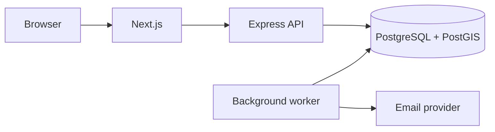

# Kin

Kin is a community blood donor coordination platform that connects people seeking donors with people willing to help. It supports the process from publishing a hospital request to confirming donor arrangements and sharing contact details privately.

## Features

- **Donor profiles:** Blood group, location, availability, travel radius, and email invitation preferences.
- **Blood requests:** Hospital details, collection destination, donor requirements, deadlines, and arrival windows.
- **Location-based outreach:** PostGIS distance filtering and staged invitations based on blood group, availability, and travel preferences.
- **Donor coordination:** Offers, confirmations, cancellations, and renewed outreach when an arrangement falls through.
- **Private contact sharing:** Participants choose whether to share their phone number within an active confirmed arrangement.
- **Account security:** Email OTP verification, password recovery, server-side sessions, CSRF protection, and rate limiting.
- **Notifications and moderation:** Email and in-app updates, user reports, request cancellation, and account suspension by administrators.

## Tech stack

| Layer | Technologies |
| --- | --- |
| Language | TypeScript |
| Frontend | Next.js, React, CSS |
| Backend | Node.js, Express, Zod |
| Database | PostgreSQL, PostGIS |
| Email | Brevo or Resend |

## Architecture

The frontend communicates with an Express API organized into routes, controllers, services, and repositories. Services handle domain rules and database transactions. A separate Node.js worker processes outreach, email delivery, retries, and expiry tasks stored in PostgreSQL.



- **Commitment safeguards:** Request row locks protect donor capacity. Advisory locks and a partial unique index restrict each donor to one active confirmed commitment.
- **Transactional notifications:** Domain updates and their associated notification jobs commit together.
- **Background processing:** Workers claim jobs with `SKIP LOCKED`, retry failures with exponential backoff, and recover stale claims.
- **Contact access:** Phone-number access checks participation, sharing consent, and the arrangement's active status.

## Project structure

```text
apps/web/             Pages, components, styles, and API client
apps/api/src/         API, domain services, repositories, and worker
database/migrations/  Database schema and migrations
scripts/              Development and process startup scripts
```

## Scope

Kin coordinates donor arrangements; hospitals and blood centres determine clinical eligibility and collection requirements. A confirmed arrangement is a commitment to attend, not proof of a completed donation. The platform does not provide blood-bank inventory or blood transport.

Scheduled outreach and email delivery require the worker to be running. Email retries can produce duplicate messages after ambiguous provider failures.

## Assets

The community photograph is generated illustrative imagery. Noto Sans is bundled with its [licence](apps/web/public/fonts/LICENSE.txt).
